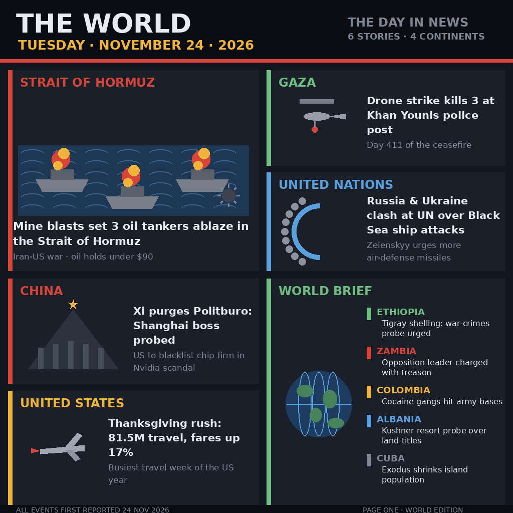

# The World — Tuesday, November 24, 2026

Entry for make.fun [news-image-20261124](https://make.fun/bounty/news-image-20261124): one image that summarizes the day's news (Nov 24 2026) across four continents — six stories, drawn as a front-page poster.

[](https://make.fun/bounty/news-image-20261124?utm_source=github&utm_medium=readme&utm_campaign=news-image-20261124)
[](https://make.fun/bounty/news-image-20261124/leaderboard?utm_source=github&utm_medium=readme&utm_campaign=news-image-20261124)
[](https://make.fun/bounty/news-image-20261124?utm_source=github&utm_medium=readme&utm_campaign=news-image-20261124)



## Run

Deterministic: writes the same bytes on every run.

```bash
mkdir -p out && MAKEFUN_OUTPUT_DIR=out node main.ts
```

- 1024×1024 PNG, procedural poster: masthead with the date, six story panels (Strait of Hormuz tanker attacks, Gaza drone strike, UN Security Council, China Politburo purge, US Thanksgiving travel, world brief).
- main.ts (Node 22, standard library only) copies `entry.png` to `$MAKEFUN_OUTPUT_DIR` twice, byte-identical.
